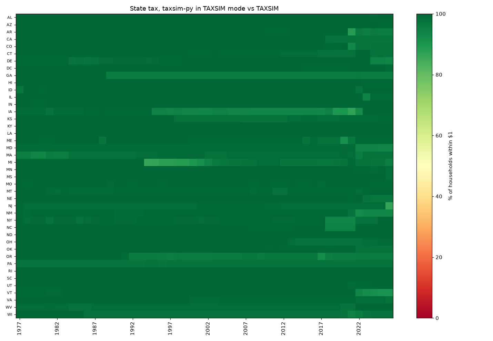
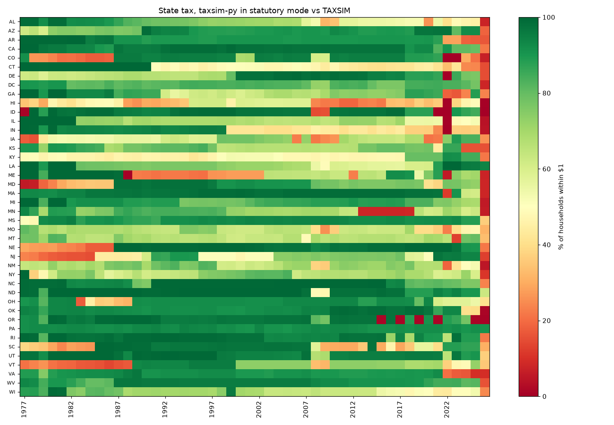
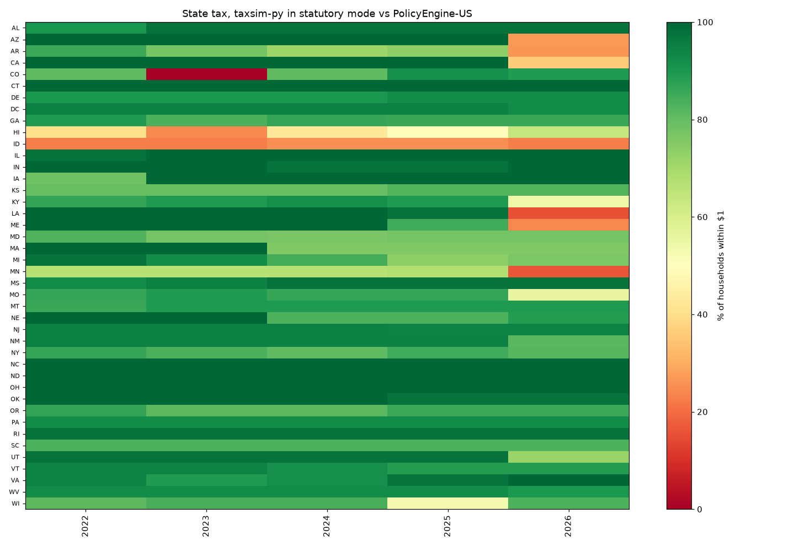

# Comparison with TAXSIM and PolicyEngine-US

This page is generated by `scripts/build_comparison_report.py`. It compares taxsim-py with the TAXSIM
executable and with PolicyEngine-US on real households, for every state and year.

## Households

The households are the 200 randomly drawn CPS ASEC tax units per state from the 2011
public-use file (income year 2010), 10,200 units in all, built with
`taxsim_py.prep.cps_asec_tax_units`. For each law year from 1960 to 2026 the same units are run with every
dollar input multiplied by the ratio of that year's consumer price index to 2010's (2025 and 2026 use assumed
2.7% and 2.5% inflation), so each year sees a realistic mix at that year's prices. Before 1977 only the federal return
is calculated. TAXSIM itself is run one state and one year at a time, because its results for a record depend on
the records that ran before it (variables left over from another state's routine; Maryland 1977-1984 differs by
about $90 per household when mixed with other states). A household "agrees" when the tax differs by $1 or less. Federal rows count all units; state rows count the
states with a wage income tax.

## Against TAXSIM

*TAXSIM mode* reproduces the executable, bugs included. *Statutory mode* follows the law, so it is expected to differ
where TAXSIM is wrong or out of date; each difference is listed in [TAXSIM errors and
corrections](statutory_corrections.md).

Over all states and years since 1977, **99.1%** of households agree with TAXSIM's state tax in
TAXSIM mode (99.0% within 2 cents), and **75.1%** in statutory
mode.

### Federal income tax

| Years | TAXSIM mode within 2 cents | TAXSIM mode within $1 | Statutory within $1 |
|:--|:--:|:--:|:--:|
| 1960-1976 | 100.0% | 100.0% | 100.0% |
| 1977-1989 | 99.8% | 99.9% | 94.2% |
| 1990-1999 | 99.8% | 99.8% | 94.7% |
| 2000-2009 | 99.6% | 99.6% | 84.9% |
| 2010-2019 | 99.8% | 99.8% | 89.8% |
| 2020-2026 | 99.7% | 99.7% | 87.8% |

### State income tax: TAXSIM mode

### State income tax: statutory mode

The tables give the percent of households that agree, averaged over each period (the first group of columns is TAXSIM
mode, the second statutory mode).

| State | TAXSIM mode 1977-1989 | TAXSIM mode 1990-1999 | TAXSIM mode 2000-2009 | TAXSIM mode 2010-2019 | TAXSIM mode 2020-2026 | Statutory 1977-1989 | Statutory 1990-1999 | Statutory 2000-2009 | Statutory 2010-2019 | Statutory 2020-2026 |
|:--|:--:|:--:|:--:|:--:|:--:|:--:|:--:|:--:|:--:|:--:|
| AL | 100 | 100 | 100 | 100 | 100 | 92 | 76 | 63 | 52 | 38 |
| AZ | 100 | 100 | 100 | 100 | 100 | 72 | 92 | 90 | 91 | 82 |
| AR | 100 | 100 | 100 | 100 | 95 | 97 | 89 | 90 | 90 | 41 |
| CA | 100 | 100 | 100 | 100 | 97 | 95 | 98 | 98 | 96 | 75 |
| CO | 100 | 100 | 100 | 100 | 97 | 44 | 95 | 83 | 94 | 33 |
| CT | 100 | 100 | 100 | 99 | 98 | 100 | 53 | 49 | 43 | 32 |
| DE | 99 | 99 | 100 | 100 | 98 | 64 | 68 | 98 | 95 | 61 |
| DC | 100 | 100 | 100 | 100 | 100 | 85 | 83 | 81 | 81 | 72 |
| GA | 100 | 95 | 95 | 95 | 96 | 93 | 66 | 66 | 77 | 49 |
| HI | 100 | 100 | 100 | 100 | 100 | 40 | 45 | 51 | 27 | 29 |
| ID | 100 | 100 | 100 | 100 | 100 | 89 | 97 | 81 | 96 | 50 |
| IL | 100 | 100 | 100 | 100 | 99 | 84 | 69 | 66 | 67 | 38 |
| IN | 100 | 100 | 100 | 100 | 100 | 95 | 89 | 42 | 41 | 25 |
| IA | 99 | 97 | 94 | 93 | 96 | 47 | 63 | 59 | 62 | 57 |
| KS | 100 | 100 | 98 | 98 | 99 | 82 | 78 | 67 | 75 | 49 |
| KY | 100 | 100 | 100 | 100 | 100 | 47 | 47 | 50 | 54 | 76 |
| LA | 100 | 100 | 100 | 100 | 100 | 87 | 76 | 67 | 58 | 91 |
| ME | 100 | 100 | 99 | 99 | 98 | 85 | 23 | 54 | 67 | 56 |
| MD | 99 | 99 | 99 | 99 | 96 | 42 | 96 | 89 | 76 | 56 |
| MA | 96 | 99 | 98 | 98 | 98 | 95 | 98 | 98 | 98 | 61 |
| MI | 100 | 92 | 96 | 97 | 97 | 93 | 82 | 85 | 88 | 64 |
| MN | 100 | 100 | 100 | 100 | 99 | 82 | 82 | 70 | 31 | 56 |
| MS | 100 | 100 | 100 | 100 | 100 | 84 | 91 | 94 | 93 | 83 |
| MO | 100 | 100 | 100 | 100 | 100 | 70 | 69 | 58 | 59 | 38 |
| MT | 99 | 99 | 99 | 99 | 100 | 72 | 66 | 63 | 66 | 59 |
| NE | 100 | 100 | 100 | 100 | 98 | 41 | 99 | 97 | 98 | 86 |
| NJ | 99 | 98 | 99 | 99 | 97 | 28 | 71 | 65 | 73 | 77 |
| NM | 99 | 99 | 99 | 99 | 94 | 70 | 75 | 60 | 73 | 43 |
| NY | 99 | 99 | 99 | 98 | 97 | 65 | 68 | 75 | 69 | 56 |
| NC | 100 | 100 | 100 | 99 | 98 | 94 | 97 | 100 | 95 | 71 |
| ND | 100 | 100 | 100 | 100 | 100 | 99 | 100 | 89 | 96 | 87 |
| OH | 100 | 100 | 100 | 99 | 98 | 64 | 92 | 92 | 91 | 60 |
| OK | 100 | 100 | 100 | 100 | 98 | 93 | 92 | 93 | 98 | 64 |
| OR | 100 | 97 | 96 | 96 | 96 | 96 | 97 | 94 | 68 | 50 |
| PA | 97 | 97 | 97 | 97 | 98 | 92 | 93 | 92 | 92 | 91 |
| RI | 100 | 100 | 100 | 100 | 100 | 97 | 99 | 95 | 91 | 78 |
| SC | 100 | 100 | 100 | 100 | 100 | 57 | 97 | 87 | 42 | 68 |
| UT | 100 | 100 | 100 | 100 | 100 | 98 | 99 | 89 | 95 | 81 |
| VT | 100 | 100 | 100 | 100 | 94 | 25 | 95 | 65 | 72 | 54 |
| VA | 100 | 100 | 99 | 99 | 99 | 90 | 92 | 90 | 90 | 37 |
| WV | 98 | 98 | 98 | 98 | 99 | 89 | 96 | 95 | 91 | 74 |
| WI | 99 | 98 | 98 | 98 | 97 | 82 | 73 | 65 | 57 | 45 |

State-years where TAXSIM mode agrees for less than 95% of households:

| State | Year | Share within $1 |
|:--|:--:|:--:|
| MI | 1994 | 86% |
| MI | 1995 | 86% |
| NJ | 2026 | 86% |
| IA | 2021 | 87% |
| MI | 1996 | 88% |
| MI | 1997 | 88% |
| AR | 2021 | 88% |
| MI | 1998 | 88% |
| MI | 1999 | 88% |
| IA | 2019 | 90% |
| MI | 2000 | 90% |
| IA | 2020 | 90% |
| VT | 2025 | 91% |
| VT | 2026 | 91% |
| ME | 2020 | 92% |

The full state-by-year values are in [comparison_taxsim.csv](data/comparison_taxsim.csv).

## Against PolicyEngine-US

Statutory mode against PolicyEngine-US's TAXSIM interface for 2022-2026, on
40 units per state (PolicyEngine is much slower). Only households whose federal tax agrees within $1
count, so the comparison is of state logic. PolicyEngine's adapter ignores `dep6` and turns the dependent counts into
children of default ages, so credits that depend on a child's age differ in ways that are not errors in either model.
Where the two disagree, the form or statute decides; the known cases are in [Comparison with
PolicyEngine-US](policyengine_recent_state_comparison.md).

| State | 2022 | 2023 | 2024 | 2025 | 2026 |
|:--|:--:|:--:|:--:|:--:|:--:|
| AL | 90 | 97 | 97 | 97 | 97 |
| AZ | 100 | 100 | 100 | 100 | 27 |
| AR | 85 | 77 | 71 | 74 | 26 |
| CA | 100 | 100 | 100 | 100 | 36 |
| CO | 81 | 0 | 81 | 92 | 89 |
| CT | 100 | 100 | 100 | 100 | 100 |
| DE | 89 | 89 | 89 | 92 | 92 |
| DC | 95 | 95 | 95 | 95 | 92 |
| GA | 89 | 83 | 86 | 86 | 86 |
| HI | 41 | 24 | 43 | 50 | 64 |
| ID | 23 | 23 | 26 | 26 | 23 |
| IL | 97 | 100 | 100 | 100 | 100 |
| IN | 100 | 100 | 97 | 97 | 100 |
| IA | 78 | 100 | 100 | 100 | 100 |
| KS | 79 | 79 | 79 | 82 | 82 |
| KY | 86 | 89 | 92 | 89 | 54 |
| LA | 100 | 100 | 100 | 97 | 15 |
| ME | 100 | 100 | 100 | 85 | 24 |
| MD | 82 | 78 | 77 | 78 | 78 |
| MA | 100 | 100 | 76 | 76 | 76 |
| MI | 97 | 92 | 84 | 74 | 76 |
| MN | 67 | 67 | 67 | 68 | 16 |
| MS | 92 | 95 | 97 | 97 | 97 |
| MO | 86 | 89 | 86 | 86 | 56 |
| MT | 86 | 89 | 89 | 89 | 89 |
| NE | 100 | 100 | 83 | 83 | 89 |
| NJ | 95 | 95 | 95 | 94 | 94 |
| NM | 95 | 95 | 95 | 95 | 82 |
| NY | 86 | 83 | 81 | 85 | 82 |
| NC | 100 | 100 | 100 | 100 | 100 |
| ND | 100 | 100 | 100 | 100 | 100 |
| OH | 100 | 100 | 100 | 100 | 100 |
| OK | 100 | 100 | 100 | 97 | 97 |
| OR | 86 | 81 | 81 | 85 | 85 |
| PA | 92 | 92 | 92 | 92 | 92 |
| RI | 97 | 97 | 97 | 97 | 97 |
| SC | 83 | 83 | 83 | 83 | 83 |
| UT | 97 | 97 | 97 | 97 | 72 |
| VT | 94 | 94 | 91 | 89 | 89 |
| VA | 94 | 89 | 92 | 97 | 100 |
| WV | 92 | 92 | 92 | 92 | 90 |
| WI | 81 | 84 | 84 | 53 | 83 |

The full values are in [comparison_policyengine.csv](data/comparison_policyengine.csv).
